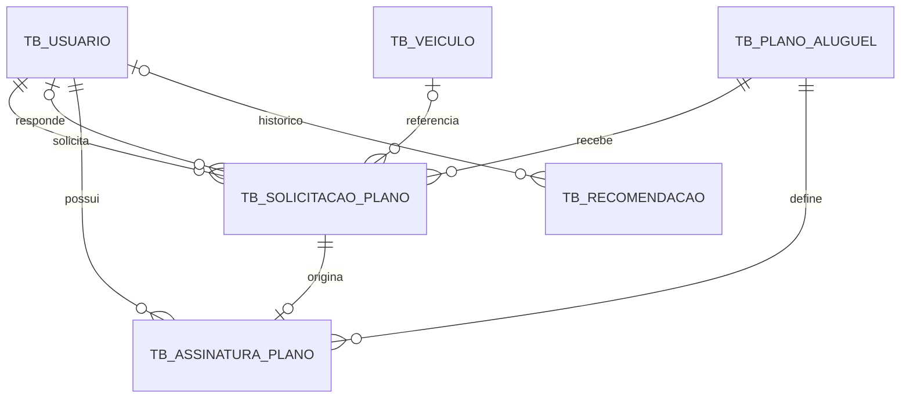
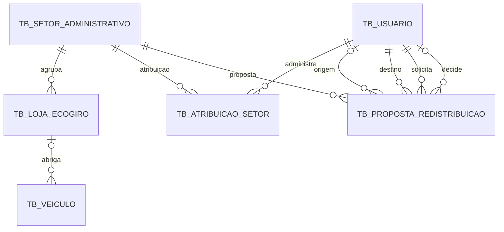

# BL03 / BL23 — Modelo de dados, DER e dicionário

Auditoria em 15/10/2026, branch 11 do fork. Fonte: entidades JPA em `com.example.ecogiro.model` e respectivos repositories. Nomes físicos indicados em minúsculas: PostgreSQL normaliza identificadores não delimitados; propriedades sem `@Column(name)` usam snake_case do Spring. Todos os IDs são BIGINT gerados por IDENTITY. Nenhum dado pessoal de produção está incluído.

## DER — contas, planos e solicitações

Um usuário pode solicitar diferentes planos; uma solicitação pode gerar no máximo uma assinatura (FK única). `respondido_por` é opcional. Recomendações anônimas não têm usuário. O veículo da solicitação é opcional apenas no armazenamento de registros anteriores; novas solicitações exigem seleção. A referência ao veículo não constitui reserva ou aluguel físico.

## DER — território

As quatro relações da proposta com usuário usam FKs diferentes: `from_admin_id` opcional, `to_admin_id` obrigatório, `requested_by_id` obrigatório e `decided_by_id` opcional. A combinação administrador/setor é única no banco; o serviço recusa atribuição ambígua e serializa aprovação por setor. O banco não impõe exclusividade de um único administrador por setor através dessa combinação; a regra adicional é do serviço.

## Enumerações persistidas como texto

| Enumeração | Valores | Uso |
| --- | --- | --- |
| Role | USER, ADMIN, ADMIN_GERAL, ADMIN_SETORIAL | Usuário; ADMIN é legado |
| VehicleType | MOTO, BIKE, E_BIKE, SCOOTER | Tipo do veículo |
| VehicleStatus | AVAILABLE, RENTED, MAINTENANCE, INACTIVE | Estado da frota |
| PlanRequestStatus | PENDING, APPROVED, REJECTED, CANCELLED | Solicitação de plano |
| SubscriptionStatus | ACTIVE, EXPIRED, CANCELLED | Assinatura |
| SectorRedistributionProposal.Status | PENDING, APPROVED, REJECTED, CANCELLED | Proposta territorial |

`vehicleCategory` do plano é uma String validada por serviço: TODOS, MOTO_E_ELETRICOS ou um VehicleType. Não é uma enumeração JPA. Para bases antigas, a regra CHECK de Role deve ser migrada conforme o script já documentado.

## Dicionário de dados

Obrigatório abaixo significa `nullable=false` ou PK no mapeamento JPA; não implica que todos os controles de negócio sejam constraints SQL. Timestamps usam LocalDateTime sem fuso; o fuso de apresentação não altera o armazenamento. Comprimentos são os declarados; String sem tamanho explícito usa o padrão JPA (255).

### tb_setor_administrativo — AdministrativeSector

| Campo / coluna | Tipo | Obrigatório | Observação |
| --- | --- | --- | --- |
| `id` / `id` | BIGINT | Sim | PK; IDENTITY |
| `code` / `code` | VARCHAR(40) | Sim | — |
| `name` / `name` | VARCHAR(120) | Sim | — |
| `active` / `active` | BOOLEAN | Sim | — |

### tb_atribuicao_setor — AdministratorSectorAssignment

| Campo / coluna | Tipo | Obrigatório | Observação |
| --- | --- | --- | --- |
| `id` / `id` | BIGINT | Sim | PK; IDENTITY |
| `administrator` / `administrator_id` | BIGINT | Sim | FK → tb_usuario.id |
| `sector` / `sector_id` | BIGINT | Sim | FK → tb_setor_administrativo.id |
| `assignedAt` / `assigned_at` | TIMESTAMP | Sim | Não atualizado pelo JPA |

### tb_usuario — AppUser

| Campo / coluna | Tipo | Obrigatório | Observação |
| --- | --- | --- | --- |
| `id` / `id` | BIGINT | Sim | PK; IDENTITY |
| `fullName` / `full_name` | VARCHAR(120) | Sim | — |
| `cpf` / `cpf` | VARCHAR(11) | Sim | — |
| `age` / `age` | INTEGER | Sim | — |
| `email` / `email` | VARCHAR(180) | Sim | — |
| `password` / `password` | VARCHAR(100) | Sim | — |
| `role` / `role` | VARCHAR(20) | Sim | Enum Role |
| `active` / `active` | BOOLEAN | Sim | — |
| `createdAt` / `created_at` | TIMESTAMP | Sim | Não atualizado pelo JPA |

### tb_loja_ecogiro — EcoGiroStore

| Campo / coluna | Tipo | Obrigatório | Observação |
| --- | --- | --- | --- |
| `id` / `id` | BIGINT | Sim | PK; IDENTITY |
| `code` / `code` | VARCHAR(40) | Sim | — |
| `name` / `name` | VARCHAR(120) | Sim | — |
| `sector` / `sector_id` | BIGINT | Sim | FK → tb_setor_administrativo.id |
| `latitude` / `latitude` | DOUBLE | Sim | — |
| `longitude` / `longitude` | DOUBLE | Sim | — |
| `active` / `active` | BOOLEAN | Sim | — |
| `capacity` / `capacity` | INTEGER | Não | — |
| `blocked` / `blocked` | BOOLEAN | Não | — |

### tb_solicitacao_plano — PlanRequest

| Campo / coluna | Tipo | Obrigatório | Observação |
| --- | --- | --- | --- |
| `id` / `id` | BIGINT | Sim | PK; IDENTITY |
| `user` / `usuario_id` | BIGINT | Sim | FK → tb_usuario.id |
| `plan` / `plano_id` | BIGINT | Sim | FK → tb_plano_aluguel.id |
| `status` / `status` | VARCHAR(20) | Sim | Enum PlanRequestStatus |
| `userMessage` / `user_message` | VARCHAR(500) | Não | — |
| `adminResponse` / `admin_response` | VARCHAR(500) | Não | — |
| `respondedBy` / `respondido_por` | BIGINT | Não | FK → tb_usuario.id |
| `requestedAt` / `requested_at` | TIMESTAMP | Sim | Não atualizado pelo JPA |
| `respondedAt` / `responded_at` | TIMESTAMP | Não | — |
| `protocol` / `protocol` | VARCHAR(36) | Não | Não atualizado pelo JPA |
| `vehicle` / `veiculo_id` | BIGINT | Não | FK → tb_veiculo.id |

### tb_recomendacao — Recommendation

| Campo / coluna | Tipo | Obrigatório | Observação |
| --- | --- | --- | --- |
| `id` / `id` | BIGINT | Sim | PK; IDENTITY |
| `distancia` / `distancia` | VARCHAR(255) | Não | — |
| `esforco` / `esforco` | VARCHAR(255) | Não | — |
| `finalidade` / `finalidade` | VARCHAR(255) | Não | — |
| `habilitacao` / `habilitacao` | VARCHAR(255) | Não | — |
| `orcamento` / `orcamento` | VARCHAR(255) | Não | — |
| `recomendacaoPrincipal` / `recomendacao_principal` | VARCHAR(255) | Não | — |
| `recomendacaoAlternativa` / `recomendacao_alternativa` | VARCHAR(255) | Não | — |
| `user` / `usuario_id` | BIGINT | Não | FK → tb_usuario.id |
| `createdAt` / `created_at` | TIMESTAMP | Sim | Não atualizado pelo JPA |

### tb_plano_aluguel — RentalPlan

| Campo / coluna | Tipo | Obrigatório | Observação |
| --- | --- | --- | --- |
| `id` / `id` | BIGINT | Sim | PK; IDENTITY |
| `name` / `name` | VARCHAR(80) | Sim | — |
| `description` / `description` | VARCHAR(500) | Sim | — |
| `price` / `price` | DECIMAL(10,2) | Sim | — |
| `durationDays` / `duration_days` | INTEGER | Sim | — |
| `vehicleCategory` / `vehicle_category` | VARCHAR(40) | Sim | — |
| `active` / `active` | BOOLEAN | Sim | — |
| `createdAt` / `created_at` | TIMESTAMP | Sim | Não atualizado pelo JPA |

### tb_proposta_redistribuicao — SectorRedistributionProposal

| Campo / coluna | Tipo | Obrigatório | Observação |
| --- | --- | --- | --- |
| `id` / `id` | BIGINT | Sim | PK; IDENTITY |
| `sector` / `sector_id` | BIGINT | Sim | FK → tb_setor_administrativo.id |
| `fromAdministrator` / `from_admin_id` | BIGINT | Não | FK → tb_usuario.id |
| `toAdministrator` / `to_admin_id` | BIGINT | Sim | FK → tb_usuario.id |
| `requestedBy` / `requested_by_id` | BIGINT | Sim | FK → tb_usuario.id |
| `decidedBy` / `decided_by_id` | BIGINT | Não | FK → tb_usuario.id |
| `status` / `status` | VARCHAR(20) | Sim | Enum Status |
| `reason` / `reason` | VARCHAR(500) | Sim | — |
| `createdAt` / `created_at` | TIMESTAMP | Sim | Não atualizado pelo JPA |
| `decidedAt` / `decided_at` | TIMESTAMP | Não | — |

### tb_assinatura_plano — UserPlanSubscription

| Campo / coluna | Tipo | Obrigatório | Observação |
| --- | --- | --- | --- |
| `id` / `id` | BIGINT | Sim | PK; IDENTITY |
| `user` / `usuario_id` | BIGINT | Sim | FK → tb_usuario.id |
| `plan` / `plano_id` | BIGINT | Sim | FK → tb_plano_aluguel.id |
| `request` / `solicitacao_id` | BIGINT | Sim | FK → tb_solicitacao_plano.id; UNIQUE |
| `status` / `status` | VARCHAR(20) | Sim | Enum SubscriptionStatus |
| `startDate` / `start_date` | DATE | Sim | — |
| `endDate` / `end_date` | DATE | Sim | — |
| `createdAt` / `created_at` | TIMESTAMP | Sim | Não atualizado pelo JPA |

### tb_veiculo — Vehicle

| Campo / coluna | Tipo | Obrigatório | Observação |
| --- | --- | --- | --- |
| `id` / `id` | BIGINT | Sim | PK; IDENTITY |
| `code` / `code` | VARCHAR(30) | Sim | — |
| `model` / `model` | VARCHAR(80) | Sim | — |
| `type` / `type` | VARCHAR(20) | Sim | Enum VehicleType |
| `status` / `status` | VARCHAR(20) | Sim | Enum VehicleStatus |
| `latitude` / `latitude` | DOUBLE | Sim | — |
| `longitude` / `longitude` | DOUBLE | Sim | — |
| `locationName` / `location_name` | VARCHAR(120) | Sim | — |
| `updatedAt` / `updated_at` | TIMESTAMP | Sim | — |
| `store` / `store_id` | BIGINT | Não | FK → tb_loja_ecogiro.id |

## Unicidade e índices

- Usuários: email e CPF únicos.
- Veículos: código único.
- Setores e lojas: código único em cada tabela.
- Atribuições: par administrator_id/sector_id único.
- Assinaturas: solicitacao_id único.
- Solicitações: protocol único para valores persistidos; novos UUIDs no @PrePersist. Registros anteriores podem manter NULL e são expostos como LEGACY-id.
- Propostas: índice idx_proposta_status; duplicidade pendente tratada no serviço com bloqueio de setor.

## Repositories e camadas (BL22 / BL23)

Cada uma das dez entidades possui JpaRepository correspondente; o pacote repository contém buscas de negócio e bloqueios pessimistas onde há decisão concorrente. Controllers expõem contratos; services concentram autenticação, contratação, compatibilidade e operações territoriais; model contém entidades/enums; dto contém PlanRequestInput; config contém segurança e inicialização. Records específicos dos controllers anteriores foram preservados para evitar refatoração desnecessária da API.

Java 21, Gradle Wrapper e Spring Boot já existiam e compilavam na entrega anterior. Não foi criado um segundo projeto nem substituída a configuração existente. H2 é usado em testes; PostgreSQL/Neon na implantação. Consulte build.gradle, application.properties e o Dockerfile.
